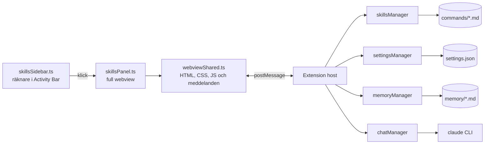
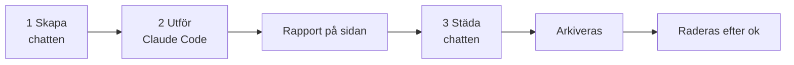

# Claude Deck

Senast ändrat: 2026-11-01

Claude Deck är ett VS Code-tillägg som fungerar som kontrollpanel för Claude Code. Det är Niclas eget dashboard för AI-systemet. Här ser man stacken (skills, MCP-servrar, hooks, minne och behörigheter) och ändrar den utan att redigera konfigurationsfiler för hand.

Projektet är en fork av [Claude Deck](https://github.com/AjaySingh10/claude-deck) av Ajay Singh. Originalet uppdateras inte längre, så den här versionen vidareutvecklas på egen hand. Licensen är MIT och originalets upphovsman står kvar i [LICENSE](LICENSE).

---

## Innehåll

- [Vad den gör](#vad-den-gör)
- [Kom igång](#kom-igång)
- [Arkitektur](#arkitektur)
- [Scope: global och projekt](#scope-global-och-projekt)
- [Överlämning via Notion](#överlämning-via-notion)
- [Hur vi bygger](#hur-vi-bygger)
- [Planerat](#planerat)
- [Krav](#krav)

---

## Vad den gör

Panelen har nio flikar. Alla fungerar i både global och projektscope.

| Flik | Syfte |
|------|-------|
| Stack | Överblick: aktiv modell, skills, MCP, hooks, minne och en hälsokontroll |
| Skills | Installera, skapa, redigera och ta bort slash-kommandon (`.md`-filer) |
| MCP | Lägg till och redigera MCP-servrar, med diff-förhandsvisning före sparning |
| Hooks | Aktivera färdiga hook-mallar eller skriv egna |
| Permissions | Redigera `allow`, `ask` och `deny` samt `defaultMode` |
| Memory | Läs minnesfiler och `CLAUDE.md` |
| Git | Status för arbetskatalogen |
| Sessions | Lista tidigare Claude Code-sessioner |
| Chat | Skicka meddelanden till `claude` från panelen, med streaming och återupptagen session |

Varje ändring i `settings.json` sparas först som en kopia. Knappen **Ångra senaste ändring** återställer den.


---

## Kom igång

Tillägget är inte publicerat på Marketplace. Det byggs och installeras lokalt.

```bash
git clone https://github.com/krabben77/claude-deck.git
cd claude-deck
npm install
npm run package        # bygger och skapar claude-deck-*.vsix
```

Installera sedan filen i VS Code:

1. `Ctrl+Shift+P`
2. **Extensions: Install from VSIX**
3. Välj `claude-deck-*.vsix`

Öppna panelen med `Ctrl+Shift+P` och kommandot **Claude: Claude Deck**, eller klicka på ikonen i Activity Bar.

### Kommandon för utveckling

```bash
npm run build          # kompilerar src/ till dist/ med esbuild (minifierat)
npm run watch          # samma, men inkrementellt och icke-minifierat
npx tsc --noEmit       # typkontroll (det finns ingen testsvit)
```

Panelens HTML, CSS och JavaScript genereras som en TypeScript-mallsträng i `src/webviewShared.ts`. Använd aldrig `\'` i den inbäddade JavaScripten, eftersom det blir `'` vid kompilering och bryter strängarna. Använd `&quot;` i `onclick`-attribut. Mer finns i [CLAUDE.md](CLAUDE.md).

---

## Arkitektur

Två ytor delar en motor: en lätt sidopanel och en full panel.



Panelen och extensionen pratar via `postMessage`. Extensionen skickar bland annat `stackData` (hela stacken i ett paket) och `installed` (installerade skills för ett scope). Filen `settings.json` bevakas med `fs.watch` på katalogen, med 100 ms debounce, så att atomiska skrivningar fångas.

Statisk data ligger i `src/data/`:

| Fil | Innehåll |
|-----|----------|
| `curatedSkills.ts` | Skill-katalogen med innehåll som installeras |
| `mcpCatalog.ts` | MCP-katalogen (poster med `envVars` får ett konfigurationsformulär) |
| `hookTemplates.ts` | Färdiga hook-mallar |
| `templates.ts` | Startmallar för nya skills |

---

## Scope: global och projekt

| Scope | Plats | Gäller |
|-------|-------|--------|
| Global | `~/.claude/` | Alla Claude Code-sessioner |
| Project | `<arbetskatalog>/.claude/` | Bara den arbetskatalogen |

Panelen öppnas i projektscope om en arbetskatalog är öppen, annars i globalt scope.

---

## Överlämning via Notion

Claude Code utför det mesta av arbetet som agent. Uppdrag går mellan Claude-chatten och Claude Code via en tillfällig Notion-sida, en handoff. Niclas fattar alla beslut. Allt som tas fram före hans "ok" är underlag.



Så går det till:

1. **Skapa.** Chatten samlar underlag, beskriver sidan och väntar på "ok". Sedan skapas sidan med typ `Handoff` och status `Ny`.
2. **Utför.** Niclas klistrar in raden nedan i Claude Code. Code sätter status `Pågår`, kontrollerar varje fynd mot koden och skriver rapporten under rubriken "Rapport". Om sidan och koden säger olika saker gäller koden.
3. **Städa.** Chatten läser rapporten, sammanfattar och sätter status `Klar` efter "ok". Bestående lärdomar sparas, sidan arkiveras och raderas först efter ytterligare ett "ok".

Raden som klistras in i Claude Code:

```text
Läs Notion-sidan <länk> och följ uppdraget på den.
```

Rapporten följer alltid samma ordning:

```text
Gjort · Verifierat · Ej verifierat · Avvikelser · Hinder · Förslag · Nästa steg
```

Reglerna för flödet ligger i skillen `handoff-notion:handoff`. Där finns också databasens inställningar, som inte upprepas här.

---

## Hur vi bygger

- Före varje skrivning beskrivs innehåll och plats, och arbetet väntar på "ok". Ett ok gäller ett arbetsblock.
- Varje utfört block loggas i [docs/BYGGLOGG.md](docs/BYGGLOGG.md), med datum, commit och Gjort · Hinder · Nästa steg.
- Öppna uppgifter finns i [TODO.md](TODO.md).
- Projektets egna skills i `.claude/skills/` används som kontroll:

| Skill | Används när |
|-------|-------------|
| `webview-template-guard` | `webviewShared.ts` ändrats, eller panelen är tom |
| `hook-template-verify` | `hookTemplates.ts` ändrats |
| `vscode-extension-debug` | Panelen eller en flik inte laddar |

---

## Planerat

Detta finns ännu inte. Se [TODO.md](TODO.md) för status.

- Marknad för Anthropics officiella skills
- Kurerat MCP-arkiv med eget format
- Plugin-vy för den egna marknaden
- Bättre chatt: historik, verktygskort, avbryt, modellväljare
- Hooks för det egna systemet
- Uppdelning av `webviewShared.ts` i moduler

---

## Krav

- VS Code 1.85 eller senare
- [Claude Code CLI](https://claude.ai/code) installerat och inloggat
- Node.js för att bygga tillägget

---

## Versionshistorik

Se [CHANGELOG.md](CHANGELOG.md).
